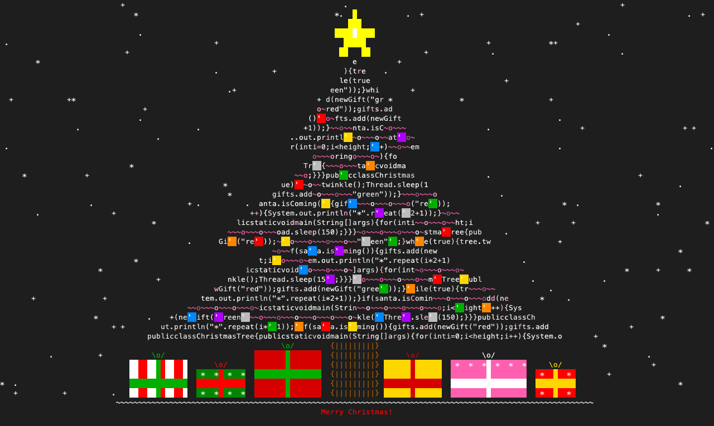

# 🎄 Terminal Christmas Tree

터미널에서 Java 코드 글자가 한 글자씩 쌓이며 크리스마스 트리가 만들어지는 애니메이션입니다.



## 이런 게 나와요

1. 갈색 기둥과 하얀 트리가 **코드 글자로 아래에서 위로** 쌓여요
2. 꼭대기에 큰 별이 뜨고, 핑크 전구 줄이 지그재그로 감겨요
3. 줄을 따라 알록달록한 오너먼트 볼이 하나씩 달려요
4. 크기와 무늬가 제각각인 선물 6개가 트리 밑에 놓여요
5. 전구·별·리본이 반짝이고 눈이 내리면서 **징글벨**이 흘러나와요 🎵

트리 크기는 실행할 때의 터미널 창 크기에 맞춰 자동으로 정해집니다.

## 실행 방법

JDK 17 이상이 필요합니다 (JDK 21에서 테스트).

```bash
javac -d out src/main/java/CodeTree.java
java -cp out CodeTree
```

- 터미널 창을 **전체화면으로 키운 다음** 실행하면 가장 예뻐요.
- 끝내려면 `Ctrl+C`를 누르세요.
- 크기를 직접 정하려면 줄 수와 칸 수를 넘기면 됩니다: `java -cp out CodeTree 40 120`

> IntelliJ의 Run 창은 커서 이동을 지원하지 않아 그림이 깨져요.
> macOS 터미널이나 IntelliJ 하단의 **Terminal 탭**에서 실행하세요.

## 꾸미기

`src/main/java/CodeTree.java`에서 아래 값만 바꾸면 됩니다.

| 바꾸고 싶은 것 | 값 |
|---|---|
| 트리를 채우는 코드 글자 | `CODE` |
| 꼭대기 별 모양 | `STAR` |
| 오너먼트 간격 / 색 | `ORNAMENT_SPACING`, `ORNAMENT_COLORS` |
| 선물 크기·색·무늬 | `GIFT_STYLES` |
| 음악 템포 / 악기 | `setTempoInBPM(160)`, `GLOCKENSPIEL` |

## 🎁 3D 오르골

같은 저장소에 3D 크리스마스 오르골도 들어 있어요. 칸마다 광선을 쏴서 입체로 그립니다.

- 빨간 받침 상자 위 유리 돔 안에서 트리·눈사람·선물이 **회전판을 따라 빙글빙글** 돌아요
- 돔 안에는 눈이 내리고, 상자 옆 태엽 손잡이도 같이 돌아가요
- 카메라가 좌우로 천천히 오가며 비추고, **고요한 밤**이 오르골 소리로 흘러나와요 🎵

### 실행 방법

```bash
javac -d out src/main/java/MusicBox.java
java -cp out MusicBox
```

- 트리와 마찬가지로 터미널 창을 크게 키운 다음 실행하고, `Ctrl+C`로 끝내요.
- 크기를 직접 정하려면: `java -cp out MusicBox 50 170`
- 창이 아주 크면 그릴 칸이 많아져서 움직임이 조금 느려질 수 있어요.

### 꾸미기

`src/main/java/MusicBox.java` 맨 위 상수를 바꾸면 됩니다.

| 바꾸고 싶은 것 | 값 |
|---|---|
| 회전판 / 손잡이 도는 속도 | `SPIN_SPEED`, `CRANK_SPEED` |
| 카메라 거리·높이·흔들림 / 확대 | `CAM_DIST`, `CAM_HEIGHT`, `CAM_SWING`, `ZOOM` |
| 상자·트리·바닥 등 색 | `LACQUER`, `GOLD`, `PINE`, `GROUND` 등 |
| 오너먼트 색 / 선물 위치·색 | `ORNAMENT_COLORS`, `GIFTS`, `GIFT_BOX_COLORS` |
| 눈송이 수 | `GLOBE_SNOW`, `SKY_SNOW_CELLS` |
| 멜로디 / 템포 | `MELODY`, `setTempoInBPM(84)` |
